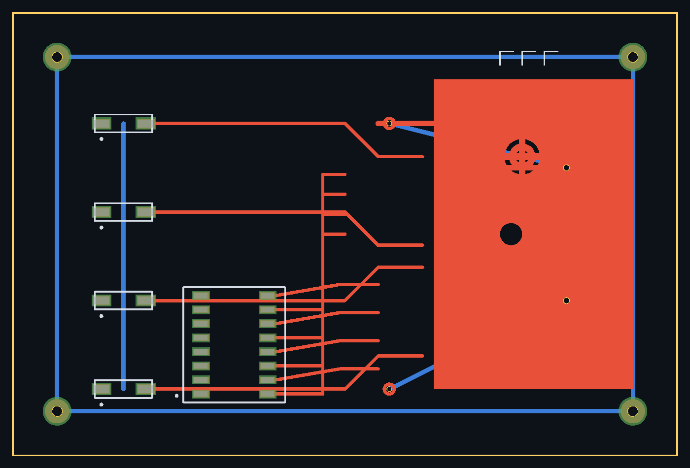
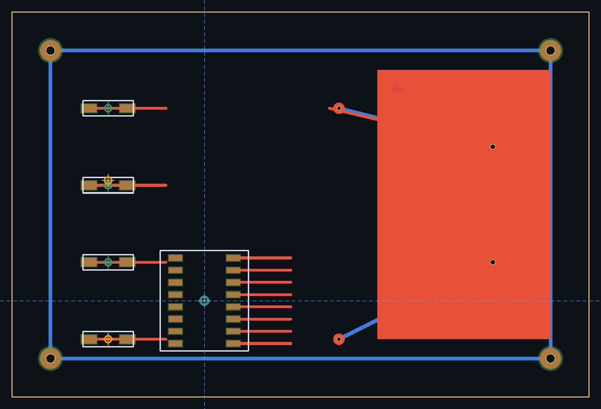
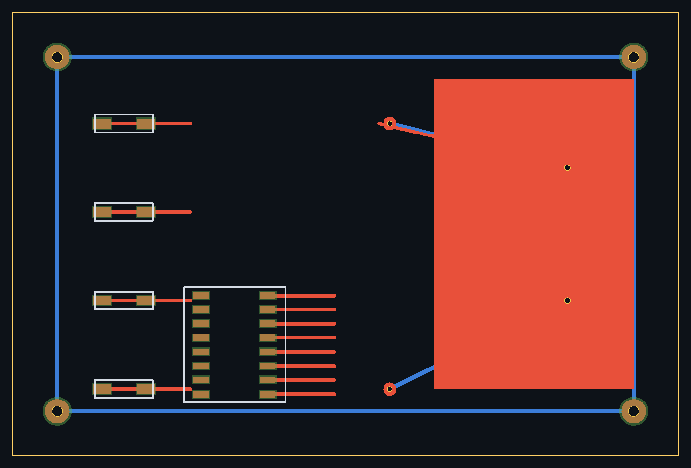
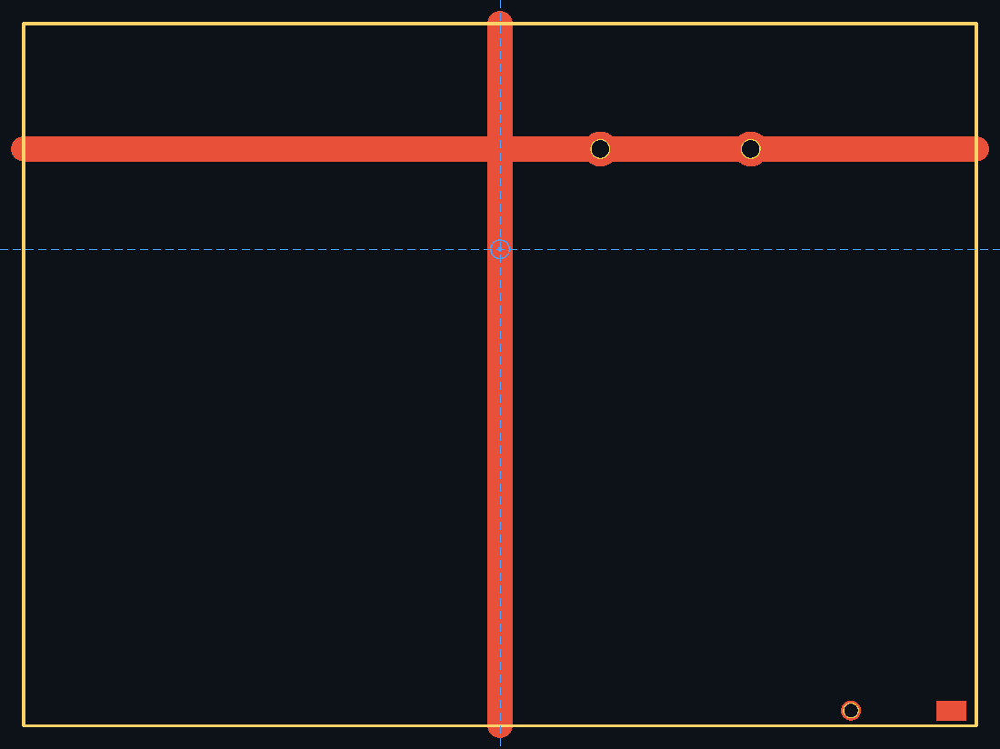

# PCB-CAM · PCB 制造资料读取与分析工具

[](https://github.com/tinuslin/pcb-cam/actions/workflows/ci.yml)
[](LICENSE)
[](https://www.python.org/)
[](#)

纯 Python 标准库实现的 PCB CAM 工具，用来**读 gerber / ODB++ 等生产资料并做工程分析**，
界面与工作流对标 CAM350 的"看图层 + 量尺寸 + 查最小线宽/环宽 + 出报告"。

- **零第三方依赖**：只用 Python 标准库（`http.server` + 自研光栅器 + 手写 PNG 编码），拷过去就能跑
- **本地 Web 界面**：浏览器里看板、切图层、调透明度、缩放平移、测距、导出；内置**本机文件浏览器**，选文件夹/单文件不用敲路径
- **能做工程判断**：板面尺寸、最小线宽、铜面积、钻孔/刀具表、环宽估算、网表比对、风险提示、Markdown 报告

## 效果预览

内置演示板（Gerber，多层叠加）由 `python -m pcb_cam.preview` 无浏览器直接出图：

| 叠加渲染 | 元件 / XY 校验叠加 |
|---|---|
|  |  |

| ODB++ 资料 | 英制（inch）资料 |
|---|---|
|  |  |

> 图片为暗色主题；Web 界面可切换亮/暗两套配色。

## 一、支持的格式

| 格式 | 说明 | 覆盖能力 |
|---|---|---|
| **Gerber RS-274X** | `.gtl/.gbl/.gts/.gbs/.gto/.gbo/.gtp/.gbp/.gko/.gm1/…` | `%FS%` 前/后零省略 + 绝对/增量、`%MO%` 英制/公制、`%AD%` C/R/O/P 光圈（含中心孔）、`%AM%` 光圈宏（原语 1/20/21/4/5/6/7/24、变量 `$n` 与算术表达式、负曝光）、`%LP%` 正/负极性、`%AB%` 光圈块、`%SR%` 步进重复、`G01/G02/G03`、`G74/G75` 单/多象限圆弧、`G36/G37` 区域、X2 属性（`TF/TA/TO/TD/IN/LN/IF/IP`）、废弃变换（`MI/IR/SF/IO/OF/AS`） |
| **Excellon 钻孔** | `.drl/.drd/.xln/.nc/.tap/…` | `M48` 文件头、`INCH/METRIC`、`M71/M72`、`;FILE_FORMAT=2:4`、刀具表（`C0.035` / `F00S00C0.800`）、前零/后零省略**自适应择优**、`G81/G82/G83` 钻孔、`G85` 槽、`G00` 快速定位与 `M15/M16` 铣槽、镀通推断 |
| **ODB++** | 目录 / `.tgz` / `.zip` 三种载体 | `matrix/matrix` 层序与类型、`steps/<step>/layers/<layer>/features`（P/L/A/S 记录 + `OB/OC/OS/OE/SE` 曲面）、标准符号（`r/s/rect/oval/el/di/oct/tri/hole`）与自定义符号、`profile` 板框、`eda/data` 网表、`components/components` 器件、`attrlist` 属性 |
| **IPC-D-356(A)** | `.ipc/.356` | `P UNITS`、`317/327/127` 测试点、`D####P/U` 孔径与镀通、`A0x` 测试面、焊盘尺寸 / 旋转 / 阻焊标记、定宽与空格混合写法容错 |

资料可以是**单文件**、**一个目录**（自动配层）、**zip/tgz 压缩包**，也可以是 ODB++ 的 step 目录。

## 二、运行

```bat
:: 方式一：双击 start-pcb-cam.bat（可把 Gerber 文件夹直接拖到 bat 上）
start-pcb-cam.bat

:: 方式二：命令行
python -m pcb_cam.server --port 8790 --open
python -m pcb_cam.server --port 8790 --open --path "D:\proj\gerber_files"

:: 端口占用或 Python 不在 PATH 时：
set PCB_CAM_PORT=8795
set PCB_CAM_PY=D:\Python312\python.exe
start-pcb-cam.bat
```

浏览器打开 <http://127.0.0.1:8790/>。首次进入会自动载入内置演示板。

需要 Python 3.8+，无需 `pip install` 任何东西。

### 命令行预览（无浏览器，直接出 PNG）

```bat
python -m pcb_cam.preview 资料路径 -o out.png -w 1600
python -m pcb_cam.preview 资料路径 -o out.png -w 1600 --theme light

:: 叠加元件坐标 / XY 校验状态 / 定位点（用于核对贴片坐标）
python -m pcb_cam.preview 资料路径 -o out.png --comps --xy 坐标.csv --goto 20,10
```

自研扫描线光栅器绘制（支持区域并集、负极性、宏光圈负曝光），适合丢进周报或做批处理截图。
`--xy` 会按校验状态着色：绿=正常、琥珀=偏差或面别不符、红=无焊盘、品红=越界。

### 自测

```bat
tests\run_tests.bat              :: 一条命令跑完全部（重建样例 -> 解析自测 -> 前端冒烟）

python tests\make_samples.py     :: 重建演示资料（Gerber / zip / ODB++ 目录 / tgz / IPC-356）
python tests\selftest.py         :: 装载 + 校验层数/孔数/板尺寸，并生成 tests\report-demo.md
node tests\ui_smoke.js static\index.html        :: 前端无头冒烟（桩 DOM + 桩 Canvas 跑真实脚本）
set PCB_SAMPLE=odb & node tests\ui_smoke.js static\index.html   :: 换 ODB++ 数据再跑一遍
```

`ui_smoke.js` 不需要浏览器：它用桩 DOM/Canvas 执行 `index.html` 里的真实脚本，检查
图层列表、钻孔面板、分析面板、网表面板能否构建，几何能否渲染（统计 fill/stroke/drawImage 次数）、
负极性是否走 `destination-out`、闪光组分支是否被命中、缩放后能否重绘、**文件浏览框能否真实取到目录列表
（盘符/快速位置/面包屑/ODB++ 识别/进入子目录/选中态）**，并捕获任何运行时异常。

## 三、界面操作

| 操作 | 说明 |
|---|---|
| **浏览…** / `Ctrl+O` | 打开**本机文件浏览器**：左侧快速位置与盘符，中间逐级进入目录，顶部面包屑，可直接粘贴路径回车跳转 |
| 左侧图层列表 | 勾选框开关图层；点**色点**只看该层；每层可单独调**透明度** |
| 拖拽 / 滚轮 | 平移 / 以光标为中心缩放 |
| `F` / `+` / `-` | 全览 / 放大 / 缩小 |
| `G` | 显示/隐藏网格 |
| `M` | 进入测距模式，点两个点显示距离（跟随当前单位） |
| **单位** 下拉 / `U` | 公制 `mm`、英制 `mil` / `inch`、双单位 `mm / mil` 循环切换，全界面统一生效 |
| `C` | 显示/隐藏元件坐标十字标记 |
| `Ctrl+O` | 打开文件浏览器 |
| `Esc` | 关闭浏览框 / 取消测距 |
| 定位区 | 填 X/Y 回车跳转；「取点」到图上取坐标；勾「视图跟随光标」随鼠标平移 |
| 顶栏输入框 | 也可直接粘贴路径后回车；点「示例」在**公制板 → ODB++ → 英制板**之间循环 |
| `U` | 切换尺寸单位（mm / mil / inch / mm+mil） |
| 导出 | 导出当前视图 PNG、导出矢量 SVG（毫米 viewBox）、下载 Markdown 分析报告 |

### 打开资料（文件浏览器）

点 **浏览…**（或按 `Ctrl+O`）后：

- 左边「快速位置」= 桌面 / 下载 / 文档 / 用户目录 / 工作目录 / **演示样例**；下面是本机盘符
- 中间列表只列 **PCB 相关资料**（Gerber、钻孔、网表、压缩包），避免一堆无关文件
- 每个文件夹带**内容提示**：`ODB++`、`9 个资料`、`压缩包` —— 直接告诉你哪一层能开
- **双击文件夹**进入，**双击文件**直接加载；也可点选后按 `Enter` / 「打开选中」
- 打开一个**文件夹** = 自动配层（顶层/底层/阻焊/丝印/钻孔…）；打开一个**文件** = 只看单层
- 找不到自己的文件时勾「**显示全部文件**」，或按目录名过滤
- 键盘：`↑` `↓` 选中，`Enter` 打开，`Esc` 关闭

右侧面板同时展示：板面尺寸、最小线宽、铜面积、钻孔统计与**刀具表**、环宽检查结果、网表信息。

### 尺寸单位：公制 + 英制

顶栏「单位」下拉（快捷键 `U`）是**全局开关**，切换后立即作用到所有尺寸显示：

| 选项 | 表现 |
|---|---|
| `mm 公制` | 全部按毫米显示，页脚同时给出 mil 对照 |
| `mil 英制` | 全部按 mil 显示（1 mil = 0.0254 mm），页脚同时给出 mm 对照 |
| `inch 英制` | 全部按 inch 显示（1 inch = 25.4 mm） |
| `mm / mil` | 双单位：表格写 `0.500 / 19.7`、正文写 `0.500 mm（19.7 mil）` |

覆盖范围：页脚坐标与距目标距离、板面尺寸、最小线宽/环宽、钻孔刀具表、测距标注、
元件列表坐标与最大偏差、XY 对齐容差输入、Markdown 报告与 CSV 导出。
解析阶段 **Gerber `%MOIN/%MOMM`、Excellon `M71/M72`、ODB++ `UNITS=`、XY 文件表头** 都会先折算成
mm 再进内存，所以英制资料与公制资料可以混在一起看；「分析」面板还会显示每个资料的**源文件单位**，
单位混用时直接进风险提示。

## 四、元件定位与 XY 坐标校验

三件事：**手动跳坐标**、**导入贴片坐标做校验**、**导出元件坐标表**。

### 1. 手动输入坐标跳转（光标跟随）

顶栏「定位」区：填 `X` / `Y` → 按 `Enter` 或点「跳转」，视图立即把该点移到画布中心，
并画出**蓝色准星 + 全幅虚线十字**。输入单位跟随顶栏「单位」开关（`mm / inch / mil`），
内部统一换算成 mm；页脚与目标标签会同时显示另一单位。

- **取点**：点「取点」后到图上点一下，屏幕坐标自动回填到 X/Y 并跳转 —— 不用手算
- **视图跟随光标**：勾上后移动鼠标，视图实时以光标为中心平移（适合沿走线巡查）
- 鼠标移到任意位置，页脚 HUD 会同时显示当前坐标 **和到目标点的距离**
- 点元件列表里的任一条目，也会跳到该元件并高亮

### 2. 导入 XY / 贴片坐标并校验

元件面板「导入…」→ 选文件。支持的写法都能自动识别（分隔符 `, ; Tab |`、有无表头均可）：

| 来源 | 典型列名 |
|---|---|
| Altium / PADS / 通用 CSV | `Designator`, `Layer`, `Footprint`, `Mid X`, `Mid Y`, `Rotation` |
| KiCad `.pos` | `Ref Val Package PosX PosY Rot Side` |
| 自定义 CSV | `Ref;X(mm);Y(mm);Rot` |
| 无表头 | `R1 10.0 30.0 0 top` |

**自动对齐**：单位（mm/inch/mil）与 **Y 轴方向**都自动判断。Y 方向不是靠猜——用板上
铜箔焊盘做证据打分：把候选朝向下的坐标逐个找"最近焊盘"，取平均距离最小的那个组合。
所以 CAD 常见的 **Y 轴向下导出** 也能自动翻正，不会整体上下颠倒。

判断错了可以在面板里手动覆盖（单位 / Y 方向 / 容差），改完立即重算。

**校验状态**（每一行都会给结论，不是只报个总数）：

| 状态 | 含义 |
|---|---|
| `ok` | 坐标落在焊盘上，且与板上器件位置一致 |
| `offset` | 焊盘对得上，但与板上器件坐标偏差超过容差（给出偏差 mm） |
| `wrong_side` | 文件写的是底层，但焊盘实际在顶层（或反之） |
| `no_pad` | 该坐标附近（默认 4 mm）找不到任何铜箔焊盘 |
| `outside` | 坐标落到板框外 |

同时反向检查**板上多出来的器件**（板上有、XY 文件里没有），这类最容易漏贴。

> 元件坐标一般是封装中心，落在两排焊盘之间，所以判定用"到最近焊盘的距离"，
> 而不是"点是否在焊盘内"——后者会把正常坐标全判成无焊盘。

### 3. 导出元件坐标表

面板「导出 CSV」：**板上器件**（来自 ODB++ `components`）或**导入的 XY 元件**都能导。

导出的列：

默认公制：

```
RefDes, Side, X(mm), Y(mm), Rotation, Package, Value, Status, Dev(mm), Source
```

把顶栏单位换成 `mil` / `inch`，表头随之变成 `X(mil)` / `X(in)`；换成 `mm / mil` 则并列输出
`X(mm), X(mil), Y(mm), Y(mil), ..., Dev(mm), Dev(mil)`。带上 `Status` 与 `Dev`，
可以把这个表直接发给贴片厂或产线核对。
ODB++ 里的器件属性（`PRP Description` 等）会填进 Value，规范里的 `%%` 转义会还原成 `%`。

## 五、分析能力（DRC-lite）

不是完整 DRC，但够做"资料能不能下厂"的第一道筛查：

- **板面尺寸**：全部图层 + 钻孔 + 板框的合并包围盒
- **最小线宽**：按铜层的走线宽度/最小光圈尺寸统计，`< 0.09 mm` 直接告警
- **铜面积**：按层累加多边形面积（区域并集、环形、组图元都算对）
- **钻孔统计**：按刀具归并，给出孔径范围、数量、镀通属性；`< 0.15 mm` 告警
- **环宽估算**：用焊盘/钻孔中心包含关系 + 网格分桶加速，给出最小环宽、`< 0.05 mm` 的孔数、**无铜环孔数**
- **网表比对**：同时存在两份网表（如 IPC-D-356 与 ODB++ `eda/data`）时做网络/点位一致性比对
- **层完整性**：有顶层铜无底层铜、有铜无钻孔文件等问题直接写进风险提示

报告末尾的"风险提示"是给人看的一句话结论，不需要自己再翻译数字。

## 六、目录结构

```
pcb-cam/
├─ pcb_cam/
│  ├─ geom.py       几何基元、圆弧展平、面积/包含判定、热焊盘形状
│  ├─ gerber.py     Gerber RS-274X 解析器（含光圈宏 / 区域 / 极性 / SR / AB）
│  ├─ excellon.py   Excellon 钻孔与槽解析器（零点约定自适应）
│  ├─ odbpp.py      ODB++ 解析器（目录 / tgz / zip 虚拟文件系统）
│  ├─ ipc356.py     IPC-D-356 网表解析与比对
│  ├─ xy.py         XY/贴片坐标解析、单位与 Y 镜像自动对齐、焊盘校验、CSV 导出
│  ├─ units.py      mm / mil / inch 换算与格式化（双单位显示、CSV 表头）
│  ├─ project.py    工程装载、图层分类配色、分析与汇总
│  ├─ report.py     Markdown 分析报告
│  ├─ raster.py     自研扫描线光栅器 + PNG 编码
│  ├─ preview.py    无浏览器 PNG 预览（可叠加元件 / XY 状态 / 定位点）
│  └─ server.py     本地 HTTP 服务（REST + 静态页）
├─ static/index.html  单文件前端（Canvas 渲染 + 交互）
├─ tests/            样例生成器、解析自测、前端冒烟、演示资料
│  ├─ make_samples.py  生成演示板（公制 Gerber / ODB++ / IPC-356 + 英制 inch 板，含宏光圈、区域、负极性、圆弧）
│  ├─ selftest.py     装载与数值校验
│  ├─ ui_smoke.js     前端无头冒烟（桩 DOM + 桩 Canvas）
│  ├─ demo-xy.csv     贴片坐标样例（覆盖 正常/偏差/面别/无焊盘 四种状态）
│  └─ run_tests.bat   一键跑全部测试
└─ start-pcb-cam.bat  一键启动
```

## 七、HTTP 接口

| 方法 | 路径 | 说明 |
|---|---|---|
| GET | `/api/state` | 是否已加载、摘要、可用演示资料列表 |
| GET | `/api/browse?path=…&all=0\|1` | 本机目录浏览（盘符 / 快速位置 / 面包屑 / 子目录与资料文件及内容提示） |
| GET | `/api/layer?i=N` | 第 N 层图元（毫米坐标） |
| GET | `/api/report?units=both\|mm\|mil\|inch` | Markdown 报告，默认双单位；加 `&download=1` 以附件下载 |
| GET | `/api/sample?name=gerber` | 载入内置演示资料 |
| POST | `/api/load` | `{"path": "D:\\proj\\gerber"}`，相对路径按项目根解析 |
| GET | `/api/export/components?source=board\|xy&units=mm\|mil\|inch\|both` | 元件 / XY 坐标 CSV，`both` 时 mm 与 mil 并列成列 |

## 八、已知边界

- 只做**读取与分析**，不做编辑/拼版/光绘输出
- **浏览框列的是「运行服务那台机器」的磁盘**。本机使用即本机文件夹；若从别的电脑访问该端口，看到的是服务端的盘符
- 资料路径始终在服务端解析，所以不需要往浏览器上传文件——几 GB 的 ODB++ 目录也能秒开
- 光圈宏里的**曝光关（负曝光）只在该宏内部镂空**，不会清除其下已绘图形——这是 Gerber X2 澄清后的规范语义（业界多数现代读图器一致）。个别老资料依赖旧行为，可能出现"焊盘看起来没挖开"的情况，属正常
- 环宽为**估算**（基于焊盘中心包含关系），复杂异形焊盘与内层负片需人工复核
- Gerber 宏里 `%AB%` 块与 `%SR%` 的组合未做嵌套展开；`IPNEG` 负片文件按正片处理后对图层取反显示，不建议用于负片资料
- DRC 不含间距（clearance）检查、不含阻抗/叠层计算
- 前端一次渲染全部图元，超过约 30 万图元的板子建议先按层过滤

---

> **免责声明**：本工具输出仅供参考，不构成任何制造或投资建议。任何投产决定请以工厂 CAM 工程复核结果为准。

## 九、许可

MIT License，见 [LICENSE](LICENSE)。可自由用于商业项目，请保留版权声明。
